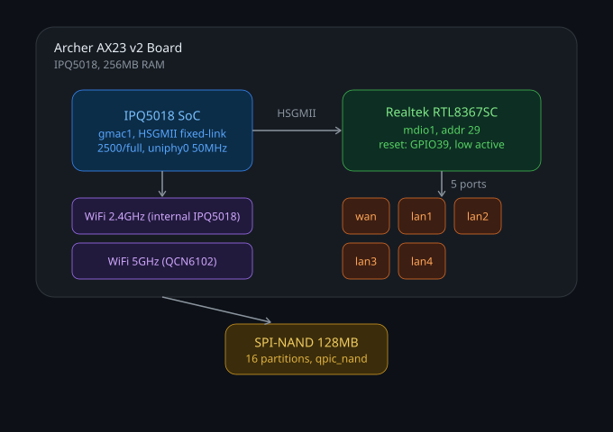

# TP-Link Archer AX23 v2 - OpenWrt port (work in progress)

This repository tracks an in-progress OpenWrt port for the **TP-Link Archer AX23 v2**
(hardware version `v2.0`, Qualcomm IPQ5018 / 256MB RAM - not to be confused with the
AX23 v1, which is MediaTek MT7621-based and already officially supported by OpenWrt).

> **Status (2026-11-14):** v0.4-2-test released. The port boots from RAM via U-Boot/TFTP,
> `br-lan` membership and LAN-to-LAN forwarding were confirmed on physical hardware by a
> community tester (v0.3). LED polarity (all 7 LEDs, `GPIO_ACTIVE_HIGH`) was confirmed on
> physical hardware (v0.4). Factory MAC address (read from `tp_data/default-mac`) and
> LAN/WAN `netdev` LED triggers are implemented in v0.4-2 and awaiting hardware validation.
> See [`docs/TESTING.md`](docs/TESTING.md) for the full test log.
>
> Persistent installation and `sysupgrade` are not validated. Wi-Fi radio operation is
> unvalidated. A/B boot handling for this board is not implemented.

## Why this exists

The AX23 v2 uses a Qualcomm IPQ5018, 256 MB of RAM and a QCN6122-class
5 GHz radio. The related AX55 v1 has 512 MB of RAM and an RTL8367S
switch. Static analysis of the AX23 v2 OEM `qca-ssdk.ko` detection
routine and the upstream `rtl8365mb` register definitions identifies
its switch as the RTL8367S-VB family D device, chip ID `0x6642`.

This tree carries the project's pre-v7/v7 ten-patch series based on
OpenWrt PR #19644. A third party reported a stable SGMII link, VLAN
bridging and clean reboots on an EX511 v2 with the same switch ID.
The AX23 v2 has separate hardware results described below;
the EX511 v2 report does not validate this board.

  

## Repository layout

| Path | Contents |
|---|---|
| `docs/HARDWARE.md` | SoC, RAM, flash, switch, radios, GPIO map, NAND partition layout |
| `docs/BUILD.md` | How to reproduce the build from this tree |
| `docs/DEVICE-TREE.md` | Walkthrough of the device tree and the decisions behind it |
| `docs/RESEARCH.md` | Vendor firmware / kernel module analysis that informed the port |
| `docs/FIRMWARE-EXTRACTION-METHOD.md` | How the vendor firmware image itself was unpacked (signature, decryption, UBI/FIT/SquashFS) - the pipeline that made `RESEARCH.md` possible |
| `docs/TESTING.md` | What has and hasn't been tested, and how to test it |
| `docs/KNOWN-ISSUES.md` | Open problems, unknowns, and licensing notes |
| `docs/archer-ax23-v2-port-status.md` | Point-in-time status snapshot with evidence tags |
| `docs/CREDITS.md` | Who wrote what - this project's own work vs. carried-in third-party patches |
| `target/` | DTS, image definition snippet, and carried-in switch driver patches for this device |
| `patches/` | Locally maintained patches applied manually during the build, including ath11k caldata and AX23 v2 board defaults |

## What is and isn't here

**Included:** our own device tree, our own image definition and caldata hotplug patch,
documentation, and OEM-vs-OpenWrt comparisons - each conclusion tagged with where it
came from (GPL source, vendor firmware inspection, upstream code, or our own testing).
The `rtl8365mb` switch driver patches under `target/linux/generic/pending-6.18/` are
**not this project's own work** - they are carried in from upstream patch submissions
by their original authors; see `docs/CREDITS.md` for who wrote what. This repo also
includes a method-level description of how the vendor firmware image was unpacked (see
`docs/FIRMWARE-EXTRACTION-METHOD.md`) - described at the mechanism level, without any
recovered key material.

**Not included, on purpose:** OEM firmware images, decrypted rootfs, partition dumps,
config backups, any keys/credentials/tokens, personal data, or logs containing real
MAC addresses or other identifiers. GPL coverage of the kernel and some drivers does
not extend to the rest of the vendor firmware, so none of that is redistributed here.
See `docs/KNOWN-ISSUES.md` for a specific note on GPL source completeness for one
vendor-supplied kernel module.

## Hardware support matrix (summary)

| Component | Status |
|---|---|
| Boot | Boots via U-Boot/TFTP to an OpenWrt shell. Confirmed on physical hardware through v0.4. v0.4-2-test compiled clean (2026-11-14); hardware validation of v0.4-2 pending. Persistent installation and `sysupgrade` remain unvalidated |
| Ethernet switch (RTL8367 family D) | DSA ports `wan` and `lan1`-`lan4` operational. HSGMII 2.5 Gbit/s CPU trunk confirmed from four independent sources (U-Boot log, stock DTB, 312.5 MHz UNIPHY clock measurement on live hardware, community tester UART log). `br-lan` membership and LAN-to-LAN forwarding confirmed on physical hardware (v0.3). LAN-to-WAN routing and NAT not yet validated |
| Default network roles | Patches `0002`-`0005` implement `lan1`-`lan4` as LAN, `wan` as WAN, factory MAC from `tp_data/default-mac`, and `netdev` LED triggers. MAC and LED trigger changes are in v0.4-2 awaiting hardware validation |
| 2.4 GHz and 5 GHz Wi-Fi | Board-data loading fails with error `-12` in current builds; root cause unknown. Radio operation is unvalidated |
| LEDs / buttons | All 7 LED nodes confirmed `GPIO_ACTIVE_HIGH` from live OEM device tree. LED polarity confirmed working on physical hardware (v0.4). LAN and WAN `netdev` triggers added in v0.4-2 (awaiting hardware test). Amber WAN LED logic (OEM `ledctrl` daemon) is a known limitation - not implemented |
| MAC address assignment | Resolved. U-Boot confirmed (via binary analysis of `appsbl.bin`) to never write a MAC into `0:ART` on this platform - that region is erased flash (`0xFF`). Factory MAC is in `tp_data/default-mac`; patches `0003`+`0004` read from there, following the same pattern as `archer-ax55-v1` and `mercusys,mr80x-v2` |

The OEM running configuration uses a forced speed of 2500, and a 312.5 MHz
UNIPHY/GMAC clock was measured on stock hardware. Its DTB also contains
`phy-mode = "sgmii"`. The HSGMII 2.5 Gbit/s CPU trunk is confirmed from four
independent sources; see [`docs/DEVICE-TREE.md`](docs/DEVICE-TREE.md) for details.

## Related upstream discussion

- OpenWrt forum thread `t/254876` - active development thread for this port (v0.2 onward), including hardware test results from community tester Veraxis.
- OpenWrt forum thread `t/249493` - UART access and OEM DTB extraction by community member `vram`.
- OpenWrt forum thread `t/225168` - earlier AX23 v2 support discussion.

See `docs/CREDITS.md` for the origin of the `rtl8365mb` switch driver patches used here.

## License

Code in `target/` follows the licensing of the OpenWrt tree it patches (GPL-2.0-or-later
unless otherwise noted in the file, and unless otherwise noted in `docs/CREDITS.md` for
carried-in third-party patches). Documentation in `docs/` is original work by the
repository author, except where it describes or credits someone else's work.
