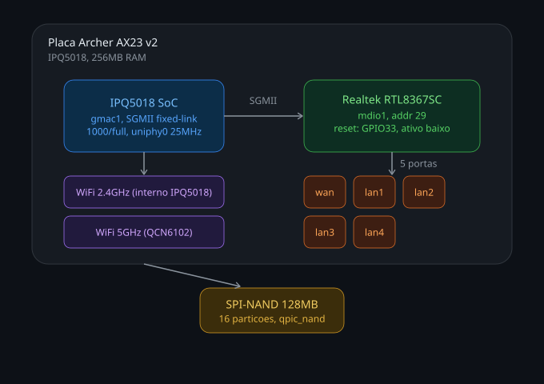

# TP-Link Archer AX23 v2 - OpenWrt port (work in progress)

This repository tracks an in-progress OpenWrt port for the **TP-Link Archer AX23 v2**
(hardware version `v2.0`, Qualcomm IPQ5018 / 256MB RAM - not to be confused with the
AX23 v1, which is MediaTek MT7621-based and already officially supported by OpenWrt).

> **Status: no functional boot on physical hardware has been demonstrated yet.**
> Everything in this repository is either a build result, a static analysis of vendor
> firmware, or an unvalidated hypothesis clearly marked as such. See
> [`docs/archer-ax23-v2-port-status.md`](docs/archer-ax23-v2-port-status.md) for the
> current, evidence-tagged state of the port.

> **Do not flash any image from this tree to a physical device.** `sysupgrade`
> support is not implemented yet (see [`docs/KNOWN-ISSUES.md`](docs/KNOWN-ISSUES.md) and
> [`docs/TESTING.md`](docs/TESTING.md)) and attempting it can brick the router. The build
> artifacts here are intended only for proposed non-persistent testing (e.g.
> RAM boot via UART/TFTP) once U-Boot console and network capabilities are verified
> on physical hardware. Neither interactive U-Boot console access nor network image
> loading has been demonstrated on this device yet - see [`docs/TESTING.md`](docs/TESTING.md).

## Why this exists

The AX23 v2 shares its SoC, RAM size, NSS/ath11k stack and QCN6102 5GHz radio with
devices already supported upstream (e.g. the EX511 v2), but uses a different Ethernet
switch (Realtek RTL8367SC/RTL8365-family) over SGMII, which is not yet wired up anywhere
in mainline OpenWrt. This repo exists to document that work so it can be picked up,
reviewed, and eventually tested by anyone with the hardware and a UART connection -
including upstream OpenWrt maintainers.

  

## Repository layout

| Path | Contents |
|---|---|
| `docs/HARDWARE.md` | SoC, RAM, flash, switch, radios, GPIO map, NAND partition layout |
| `docs/BUILD.md` | How to reproduce the build from this tree |
| `docs/DEVICE-TREE.md` | Walkthrough of the device tree and the decisions behind it |
| `docs/RESEARCH.md` | Vendor firmware / kernel module analysis that informed the port |
| `docs/FIRMWARE-EXTRACTION-METHOD.md` | How the vendor firmware image itself was unpacked (signature, decryption, UBI/FIT/SquashFS) - the pipeline that made `RESEARCH.md` possible |
| `docs/TESTING.md` | What has and hasn't been tested, and how to test it |
| `docs/KNOWN-ISSUES.md` | Open problems, unknowns, and licensing notes |
| `docs/archer-ax23-v2-port-status.md` | Point-in-time status snapshot with evidence tags |
| `docs/CREDITS.md` | Who wrote what - this project's own work vs. carried-in third-party patches |
| `target/` | DTS, image definition snippet, and carried-in switch driver patches for this device |
| `patches/` | Locally maintained patches versioned in this repository and applied manually during the build, e.g. the caldata hotplug change |

## What is and isn't here

**Included:** our own device tree, our own image definition and caldata hotplug patch,
documentation, and OEM-vs-OpenWrt comparisons - each conclusion tagged with where it
came from (GPL source, vendor firmware inspection, upstream code, or our own testing).
The `rtl8365mb` switch driver patches under `target/linux/generic/pending-6.18/` are
**not this project's own work** - they are carried in from upstream patch submissions
by their original authors; see `docs/CREDITS.md` for who wrote what. This repo also
includes a method-level description of how the vendor firmware image was unpacked (see
`docs/FIRMWARE-EXTRACTION-METHOD.md`) - described at the mechanism level, without any
recovered key material.

**Not included, on purpose:** OEM firmware images, decrypted rootfs, partition dumps,
config backups, any keys/credentials/tokens, personal data, or logs containing real
MAC addresses or other identifiers. GPL coverage of the kernel and some drivers does
not extend to the rest of the vendor firmware, so none of that is redistributed here.
See `docs/KNOWN-ISSUES.md` for a specific note on GPL source completeness for one
vendor-supplied kernel module.

## Hardware support matrix (summary)

| Component | Status |
|---|---|
| Boot (initramfs/sysupgrade build) | Builds successfully; not booted on hardware |
| Ethernet switch (RTL8367SC) | Driver patches written; SGMII link to CPU port not yet validated |
| 2.4GHz radio (IPQ5018 internal) | Caldata hotplug hook written; board data / ART offsets unvalidated; not tested |
| 5GHz radio (QCN6102) | Caldata hotplug hook written; board data / ART offsets unvalidated; not tested |
| LEDs / buttons | GPIO map known from OEM DTB; polarity not confirmed |
| MAC address assignment | Candidate NVMEM source identified; exact offset not confirmed |

## Related upstream discussion

- OpenWrt forum thread `t/249493` - UART access and OEM DTB extraction by community member `vram`.
- OpenWrt forum thread `t/225168` - earlier AX23 v2 support discussion.

See `docs/CREDITS.md` for the origin of the `rtl8365mb` switch driver patches used here.

## License

Code in `target/` follows the licensing of the OpenWrt tree it patches (GPL-2.0-or-later
unless otherwise noted in the file, and unless otherwise noted in `docs/CREDITS.md` for
carried-in third-party patches). Documentation in `docs/` is original work by the
repository author, except where it describes or credits someone else's work.
